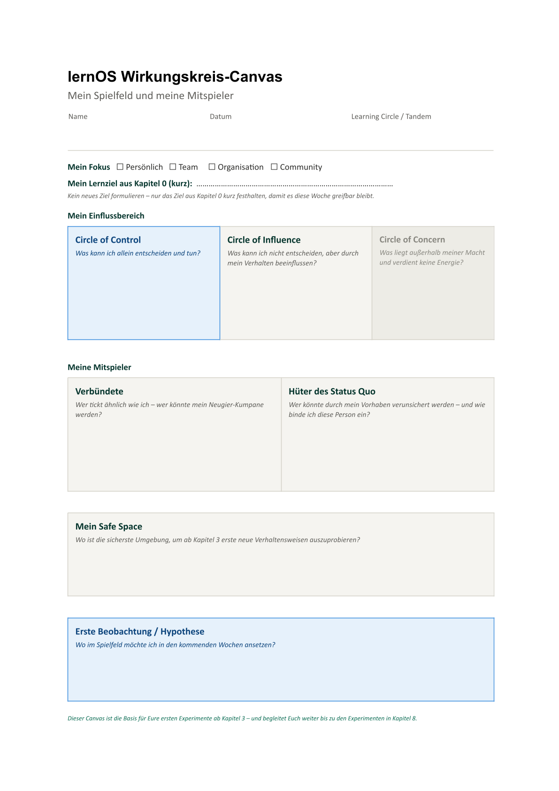

# Mitarbeit am Lernpfad

Vielen Dank für Deine Mitarbeit am Lernpfad für Neugier & Zukunftslust.

Diese Anleitung unterstützt Dich dabei, den Lernpfad gemeinsam mit anderen Autor:innen weiterzuentwickeln.

Du solltest keine Vorkenntnisse benötigen - im Zweifel kann dir aber auch jede Suchmaschine und KI weiterhelfen oder du wendest dich an die Initiator:innen des Lernpfads.

1. Workshop hat stattgefunden am 11-11-2026.

---

# 0. Was ist was?

| Werkzeug                | Zweck                                                                                                       | Wofür nutze ich es konkret?                                                                                                            |
| ----------------------- | ----------------------------------------------------------------------------------------------------------- | -------------------------------------------------------------------------------------------------------------------------------------- |
| GitHub                  | Online-Speicher und Zusammenarbeit                                                                          | Gemeinsame Plattform für den Lernpfad, Pull Requests und Reviews                                                                       |
| Git                     | Versionskontrolle                                                                                           | Nachvollziehbare Speicherung aller Änderungen und Versionen                                                                            |
| Visual Studio Code      | Projektverwaltung und Git                                                                                   | Branches erstellen, Änderungen prüfen, committen, pushen und Pull Requests vorbereiten                                                 |
| MarkText                | Einfaches Schreiben von Markdown                                                                            | Inhalte des Lernpfads schreiben und bearbeiten                                                                                         |
| lernOS Produktionskette | Erstellt automatisch HTML, PDF, DOCX und EPUB                                                               | Automatische Veröffentlichung des Lernpfads in verschiedenen Formaten                                                                  |
| Branch                  | Separater Arbeitsbereich für Änderungen ("einzig wahre", offizielle und geschützte Version = master branch) | Ermöglicht es, neue Inhalte oder Änderungen unabhängig vom Hauptstand (master) zu entwickeln, ohne die Arbeit anderer zu beeinflussen. |
| Commit                  | Gespeicherter Entwicklungsschritt                                                                           | Speichert einen definierten Zwischenstand Deiner Änderungen mit einer kurzen Beschreibung, damit diese später nachvollziehbar bleiben. |
| Pull request            | Vorschlag zur Übernahme von Änderungen                                                                      | Dient dazu, die Änderungen eines Branches zu prüfen, kommentieren und nach Freigabe in den master-Branch zu übernehmen.                |

---

# 1. Benötigte Software & Voraussetzungen

## Git

Download & Installation:

https://git-scm.com/install/windows

Sorgt für das Zusammenspiel und die Versionskontrolle aller Programme und Arbeitsstände - lokal und im öffentlichen Repository.

Hinweis: Nach der Installation von Git bitte Visual Studio Code und MarkText vollständig schließen und neu starten, falls diese schon offen sind/waren. Danach steht Git diesen Programmen normalerweise zur Verfügung.

## GitHub

GitHub ist unsere gemeinsame Plattform für die Zusammenarbeit am Lernpfad.

Bitte Konto anlegen, falls noch nicht vorhanden:

https://github.com

Nach der Registrierung bitte den GitHub-Benutzernamen für eine Einladung zum Repository https://github.com/cogneon/lernos-neugier-zukunftslust mitteilen.

## GitHub Desktop

Download & Installation:

https://desktop.github.com

GitHub Desktop vereinfacht die Zusammenarbeit mit Git und GitHub.

Hinweis: Alle Funktionen auch im Web unter https://github.com/cogneon/lernos-neugier-zukunftslust verfügbar.

## Visual Studio Code

Download & Installation:

https://code.visualstudio.com

Visual Studio Code verwenden wir für Git und die Verwaltung des Projekts.

## MarkText

Download & Installation:

https://github.com/marktext/marktext/releases

MarkText ist ein Editor für Markdown-Dateien.

---

# 2. Repository lokal herunterladen

In GitHub (Desktop) anmelden und Einladung zum Repository "lernos-neugier-zukunftslust" annehmen
Repository über GitHub Desktop klonen und lokal speichern.

Speicherort:

C:\Git-Projekte\

Empfehlung:

Nicht in OneDrive speichern.

---

# 3. Projekt in Visual Studio Code öffnen

GitHub Desktop öffnen.

Repository → Open in Visual Studio Code

---

# 4. Repository-Struktur

Wichtige Ordner:

de/src/

Enthält den eigentlichen Inhalt.

de/src/2-ff.

Enthält den praktischen Lernpfad.

de/src/1-0-Grundlagen

Soll Grundlagenwissen und -theorien enthalten (folgt).

de/src/images/

Enthält alle Bilder und Grafiken.

Nicht bearbeiten:

- docs/

- de/build/

Diese Ordner werden automatisch über Produktionskette erzeugt.

---

# 5. Vor Arbeitsbeginn vorbereiten und aktualisieren

Änderungen speichern über STRG + S oder Einstellung "Auto Save" unter "File" im Menü aktivieren
(Wichtig: Git erkennt nur gespeicherte Änderungen!)


Terminal öffnen:

Terminal → New Terminal


Testen, ob Git im Terminal verfügbar ist:

```bash
git --version
```

Es sollte beispielsweise angezeigt werden - dann wurde Git erfolgreich installiert:

```bash
git version 2.xx.x
```


Aktuellen Stand des Repos holen:

```bash
git checkout master

git pull --rebase
```

---

# 6. Eigenen Arbeitsbranch anlegen

Nicht direkt auf Branch "master"" arbeiten.

Persönlichen Branch erstellen:

```bash
git checkout -b vorname-thema
```

Beispiel:

```bash
git checkout -b martina-anpassung-wording
```

---

# 7. Texte bearbeiten

Markdown-Dateien befinden sich unter:

de/src/

Bearbeitung mit:

- **MarkText**

- oder Visual Studio Code

Empfehlung:

MarkText für den Inhalt.

Visual Studio Code für Git.

---

# 8. Zusammenspiel von MarkText und Visual Studio Code

Für die Mitarbeit verwenden wir zwei Programme parallel:

- MarkText für das Schreiben und Bearbeiten der Inhalte

- Visual Studio Code für Git und GitHub

## Warum zwei Programme?

MarkText eignet sich hervorragend zum Schreiben von Markdown-Dateien.

Visual Studio Code übernimmt die technische Verwaltung des Projekts:

- Git

- Branches

- Commits

- Pull Requests

- Synchronisierung mit GitHub

## So arbeiten beide Programme zusammen

Visual Studio Code und MarkText greifen auf dieselben Dateien im selben Ordner zu.

Beispiel:

C:\Git-Projekte\lernos-neugier-zukunftslust

Wenn Du eine Datei in MarkText bearbeitest und speicherst, erkennt Visual Studio Code diese Änderung automatisch.

Du musst Dateien nicht zwischen den Programmen übertragen. Dafür:

## Repository in MarkText öffnen

MarkText starten.

Menü:

File → Open Folder

Danach den gleichen lokalen Repository-Ordner auswählen wie zuvor in Visual Studio Code:

C:\Git-Projekte\lernos-neugier-zukunftslust

MarkText zeigt anschließend die gleiche Ordnerstruktur des Projektes an.

## Empfohlene Arbeitsweise

1. Repository und eigenen Branch in Visual Studio Code öffnen

2. Repository zusätzlich in MarkText öffnen

3. Markdown-Dateien unter de/src in MarkText bearbeiten

4. Änderungen speichern über STRG + S oder Einstellung "Auto Save" unter "File" im Menü aktivieren
   (Wichtig: Git erkennt nur gespeicherte Änderungen!)

5. Zu Visual Studio Code wechseln

6. Dort die Änderungen prüfen, committen und hochladen

## Dateien umbenennen

Dateien bitte nicht in MarkText umbenennen!

Verwende stattdessen:

- GitHub

- Visual Studio Code

- oder Git

Begründung:

MarkText legt beim Umbenennen häufig eine neue Datei an und löscht die alte Datei.

Git erkennt dies dann nicht zuverlässig als Umbenennung.

## Bilder einfügen

Bilder werden in Visual Studio Code im Ordner

de/src/images/

hinzugefügt und gespeichert.

Danach können sie in den Markdown-Text-Dateien über MarkText oder Visual Studio Code an der richtigen Stelle im Text so eingebunden werden:

```markdown

```

Beispiel:

```markdown

```

Die Bilder werden anschließend automatisch übernommen und angezeigt.

---

# 10. Änderungen in Visual Studio Code committen

In regelmäßigen Abständen sollten Änderungen in kleinen überprüfbaren Paketen z.B. nach der Anpassung einer Kata über Visual Studio Code committet werden. Einzelne Commits lassen sich einfach überprüfen und zurückdrehen als riesige Änderungsprotokolle ohne erstellten Commit.

Änderungen im Terminal von Visual Studio Code prüfen:

```bash
git status
```

Änderungen für Commit vormerken:

```bash
git add .
```

Änderung nachvollziehbar und kurz benennen und Commit erstellen:

```bash
git commit -m "Kata 5 ergänzt"
```

---

# 11. Produktionskette

Das Projekt enthält eine automatische Produktionskette.

Sie erzeugt automatisch:

- HTML

- PDF

- EPUB

- DOCX

Daher entstehen eventuell zwischenzeitlich auf deinem Branch in Git neue Änderungen, die nicht von dir selbst vorgenommen wurden.

Wenn das passiert und du trotz sauberem Committens deiner Änderungen über "git status" noch Änderungen siehst oder du "git push" nicht ausführen kannst, ist ggf. Schritt 12 nötig.

---

# 12. In Visual Studio Code vor dem Push

Eventuell nötiger Zwischenschritt vor dem Push (s. Punkt 11):
Sobald alle gewünschten Änderungen committet wurden und nicht nur lokal, sondern auch im öffentlichen Repository auf GitHub verfügbar gemacht werden sollen:

Im Terminal von Visual Studio Code ausführen:

```bash
git pull --rebase
```

Falls folgende Meldung erscheint:

Deletion of directory ...

Bitte mit

n

antworten.

Dadurch werden alle in der Zwischenzeit durch die automatische Produktionskette vorgenommenen Änderungen mit deinen persönlich vorgenommenen Änderungen vereint.

---

# 13. Änderungen in GitHub hochladen: Push

Tipp zunächst Status im Terminal von Visual Studio Code nochmals prüfen:

```bash
git status
```

Es sollten keine Änderungen mehr aufgeführt werden, sondern die Rückmeldung kommen "working tree clean"

Dann im Terminal von Visual Studio Code ausführen:

```bash
git push
```

#### Bei Fehler: "has no upstream branch"

Ursache:
Der Branch wurde lokal erstellt, wurde aber noch nicht mit GitHub verknüpft.

Lösung: Folgenden Befehl im Terminal ausführen

```bash
git push -u origin DEIN-BRANCHNAME
```

Anschließend unter GitHub überprüfen, ob im Repository https://github.com/cogneon/lernos-neugier-zukunftslust unter deinem Branch alle Änderungen erfolgreich angekommen sind (zur Auswahl der Branches das Dropdown unter dem Namen des Repos "lernos-neugier-zukunftslust" verwenden, wo in der Regel "master" vorausgewählt steht).

---

# 14. Pull Request zum Master-Branch erstellen

Wenn der Zweck deines persönlichen Branches abgeschlossen ist und alle deine gewünschten Änderungen auf GitHub vorliegen, kannst du eine Anfrage - einen sogenannten Pull Request - stellen, alle Änderungen auf deinem Branch in die Master-Version (Branch "master") unseres Lernpfads zu übernehmen.

Erstelle dafür auf GitHub einen Pull Request:

- über Button "Compare & pull request" oder

- unter "Pull requests" > "New pull request

- Wichtig: von compare: "Dein Branch" (Pfeil von rechts nach links) zu base: master

- Create pull request 
  inkl. Titel & Beschreibung 
  
  - Was wurde geändert?
  - Warum wurde es geändert?

- Wenn deine Änderungen von anderen Autor:innen überprüft werden sollen, füge sie unter "Reviewers" hinzu.

- Reviewer werden darüber benachrichtigt und können Feedback zu den Änderungen des Pull requests per Kommentar geben.

---

# 15. Feedback aus Pull Request einarbeiten

Andere Autor:innen können in deinem Pull request Feedback geben.

Bitte setze das Feedback lokal über Visual Studio Code und MarkText auf deinem Branch um - erneut wie in Schritt 7 bis 13 dieser Anleitung beschrieben.

Und danach wie immer in Visual Studio Code:

```bash
git add .

git commit -m "Feedback eingearbeitet"

git push
```

Der Pull Request aktualisiert sich automatisch.

---

# 16. Merge in den Master-Branch

Nach der inhaltlichen Freigabe deines Pull requests, kannst du nun final alle deine Änderungen in unser Master-Version, den Branch "master" übernehmen über  "Merge Pull Request". Deinen lokaler Branch kannst du nach dem erfolgreichen Merge löschen. 

Hinweis: Es entsteht automatisch in der Historie des master-Branches ein merge-Commit mit der Beschreibung "Merge pull request #x from 'Dein Branchname'" - das ist so gewollt für die Nachvollziehbarkeit. Falls dieser angezeigt wird, nicht irritieren lassen.

Danach gerne noch lokal in Visual Studio Code aktualisieren, um wieder auf den vollständigen, geänderten Stand zuzugreifen:

```bash
git checkout master

git pull --rebase
```

---

# 17. Typische Stolperfallen

### Git erkennt Änderungen nicht

Datei wurde nicht gespeichert.

Lösung:

STRG + S

---

### Direkt auf master arbeiten

Bitte vermeiden.

Immer zunächst einen eigenen Branch erstellen.

---

### MarkText zum Umbenennen von Dateien verwenden

Bitte vermeiden.

Dateien besser direkt auf GitHub oder in Visual Studio Code umbenennen.

---

### Repository in OneDrive speichern

Bitte vermeiden.

Lokalen Ordner verwenden.

---

### Push wird abgelehnt

Vorher ausführen:

```bash
git pull --rebase
```

-> Gerne Liste erweitern, mit Dingen, die bei euch schief gegangen sind.

---

# Zusammenfassung

## Voraussetzungen

1. Git installieren

↓

2. GitHub Account anlegen

↓

3. Einladung zum Repository annehmen

↓

4. GitHub Desktop installieren

↓

5. Visual Studio Code installieren

↓

6. MarkText installieren

↓

7. Repository klonen und öffnen

## Mitarbeit

1. Branch erstellen: git checkout -b vorname-thema

↓

2. Text bearbeiten

↓

3. Speichern

↓

4. git add .

↓

5. git commit

↓

6. (ggf. git pull --rebase)

↓

7. git push

↓

8. Pull Request erstellen und mergen

---

# Vielen Dank für Deine Mitarbeit!
